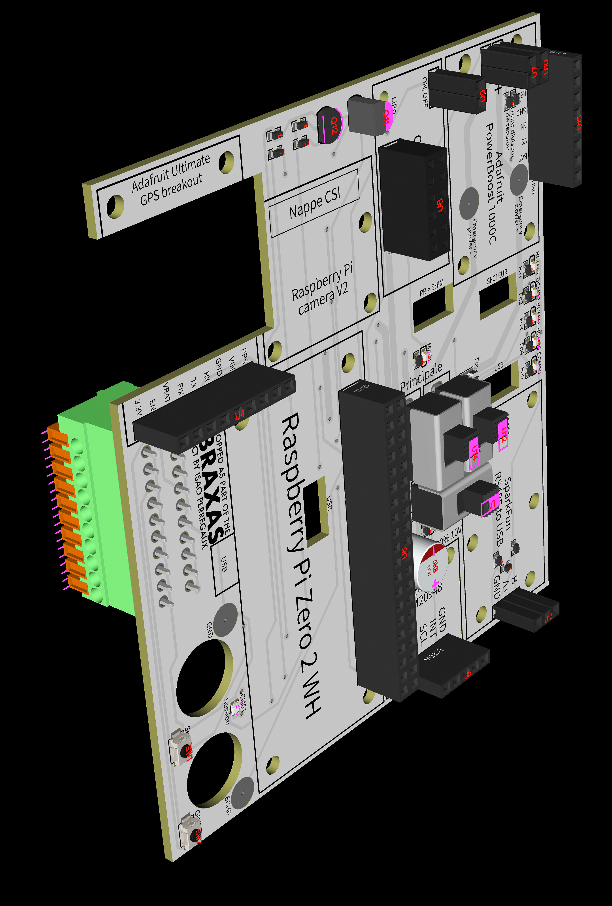

# Abraxas PCB

Printed circuit board of the Abraxas project, a lightweight and portable system developed to monitor inshore sailing training.
Main project available in the [Abraxas repository](https://github.com/isao-px/Abraxas).



## Overview

The board is the motherboard of the Abraxas enclosure. The Raspberry Pi Zero 2 WH and every breakout are plugged or screwed onto it. This removes most of the loose wiring, makes the assembly more compact and robust, and adds protections (fuse, decoupling capacitor, RS-485 resistors) that a wired prototype would not have.

| Parameter | Value |
|-----------|-------|
| Layers | 2 |
| Board size | approx. 103 × 95 mm |
| Track width | 0.5 to 1.5 mm |
| Vias | 0.6 mm drill, 1.2 mm outer diameter |
| Design software | EasyEDA |
| Manufacturer | JLCPCB |

## Repository contents

| Path | Description |
|------|-------------|
| `Fabrication/Gerber_….zip` | Gerber and drill files, ready to be sent to a PCB manufacturer |
| `Fabrication/BOM_….csv` | Bill of materials, with LCSC part numbers |
| `Fabrication/PickAndPlace_….csv` | Component positions for automated assembly |
| `SCH_Abraxas_….json` | Schematic source (EasyEDA) |
| `PCB_PCB_Abraxas_….json` | Board layout source (EasyEDA) |
| `Full_components_….schdoc` | Schematic, Altium format |
| `PCB_Abraxas_….pcbdoc` | Board layout, Altium format |
| `PCB_Abraxas_….dxf` | Board layout, DXF format |
| `OBJ_PCB_Abraxas_….zip` | 3D model of the assembled board (OBJ) |
| `Schematic_Abraxas.svg` | Schematic |
| `PCB_Abraxas.svg` | Board layout, both sides |
| `PCB_Abraxas_N&B.svg` | Board layout, both sides, black and white |
| `PCB_Abraxas_top.svg` | Board layout, top side |
| `PCB_Abraxas_bottom.svg` | Board layout, bottom side |
| `3d_pcb.jpg` | 3D render of the board with its components |

## Hosted modules

| Designator | Module |
|------------|--------|
| U6 | Raspberry Pi Zero 2 WH (2 × 20 header, all GPIO available on the board) |
| U4 | GPS, Adafruit Ultimate GPS Breakout (MTK3339) |
| U5 | IMU, Pimoroni ICM20948 breakout |
| U13 | SparkFun USB to RS-485 converter (anemometer) |
| U8, U9 | Pimoroni ON/OFF SHIM |
| U7, U10, U15 | Adafruit PowerBoost 1000C (U15 carries the LBO signal) |
| CN2 | 10-pin terminal block for the external wiring |

The camera (CSI ribbon) and the USB link between the RS-485 converter and the Raspberry do not go through the board.

## Power supply

The 5 V comes from a 3.7 V LiPo battery boosted by the PowerBoost 1000C. Two power paths are available:

```
Main:      Battery → PowerBoost → terminal block → ON/OFF SHIM → fuse F1 → circuit
Auxiliary: Battery → PowerBoost → switch U11 → fuse F1 → circuit
```

- The **main** path goes through the ON/OFF SHIM, so the device can be switched on and off from outside the sealed enclosure, and shut down by software (BCM4 set to LOW).
- The **auxiliary** path is a backup in case the main one fails. It is switched by hand with U11, so it can only be used while the enclosure is open.
- The path is selected with the slide switches U12 and U14.
- Two pads under the PowerBoost are directly connected to the regulated 5 V and to GND, as a last resort in case both paths fail.
- F1 is a resettable fuse (1.25 A hold, 2.5 A trip).
- C1 (1000 µF) is placed as close as possible to the Raspberry pins to absorb current peaks, for example when the Wi-Fi starts.

For normal use, set ALIM+ and ALIM- (U12, U14) to **PRINCIPALE** and AUXILIAIRE (U11) to **OFF**.

## Other functions

- **RS-485:** R10 and R11 (4.7 kΩ) bias the A+ and B- lines, and R12 (120 Ω) terminates them, to protect the link against signal reflections.
- **Low battery:** the LBO output of the PowerBoost goes HIGH at 5 V when the battery drops below 3.2 V. The R7 / R8 voltage divider brings it down for the 3.3 V logic of the Raspberry.
- **Status LEDs:** one LED for each power path, and five LEDs driven by BCM13, 19, 20, 21 and 26, each with its own resistor.
- **Recording LED:** a red and green bicolour LED (LED13) driven by a single GPIO, BCM1, through an NPN (Q11) and a PNP (Q12) transistor. Red when BCM1 is LOW, green when it is HIGH.
- **Switches:** the session switch and the power switch are wired to the terminal block CN2. SW1 and SW2 are push buttons on the board that bridge the same contacts, so both functions can be tested before the external switches are connected.

## External wiring

The terminal block CN2 receives:

| Signals | Connected to |
|---------|--------------|
| GND, Session | Session switch (start and stop a recording) |
| ON/OFF_1, ON/OFF_2 | Power switch (bridges the button contacts of the SHIM) |
| 5V, GND, A+, B- | Anemometer connector, pins 1 to 4 |
| ALIM_PRINCIPALE+, ALIM_PRINCIPALE- | Micro-B plug of the ON/OFF SHIM |

The full assembly procedure is described in the project documentation.

## Ordering the board

1. Send `Fabrication/Gerber_….zip` to JLCPCB or to any other PCB manufacturer.
2. Optionally, have the SMD components assembled by the manufacturer using `Fabrication/BOM_….csv` and `Fabrication/PickAndPlace_….csv`.
3. Solder the through-hole components (headers, slide switches, terminal block, transistors, capacitor) by hand.

## License

Released under the MIT License. Copyright (c) 2026 Isao Perregaux.
